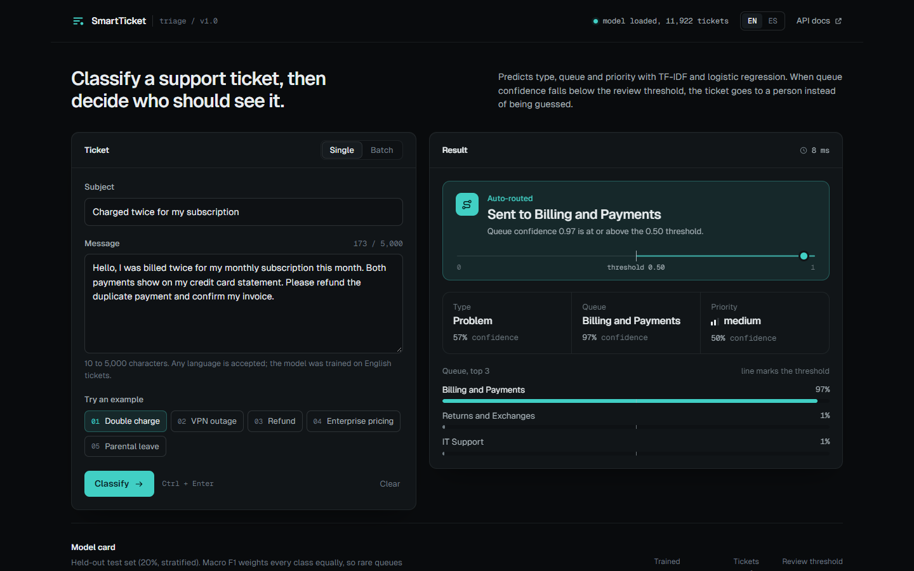
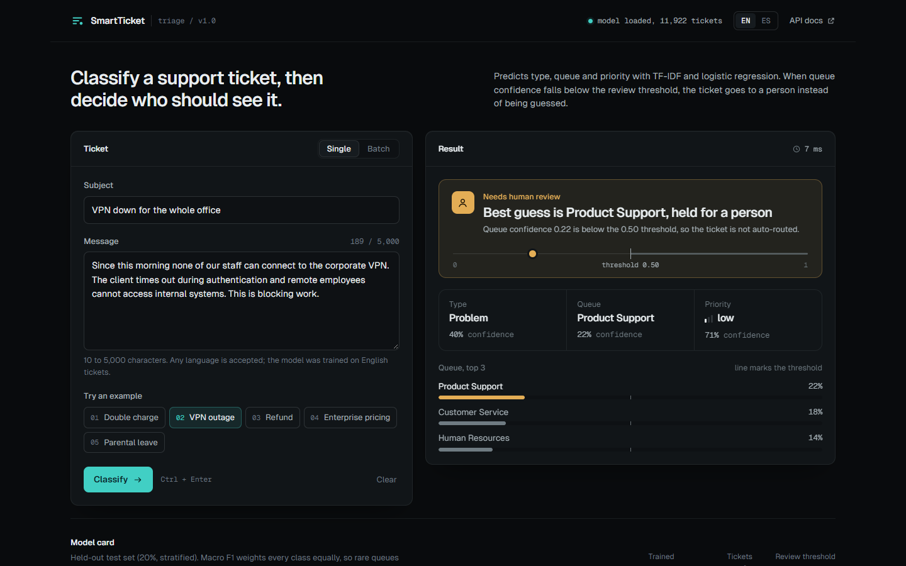
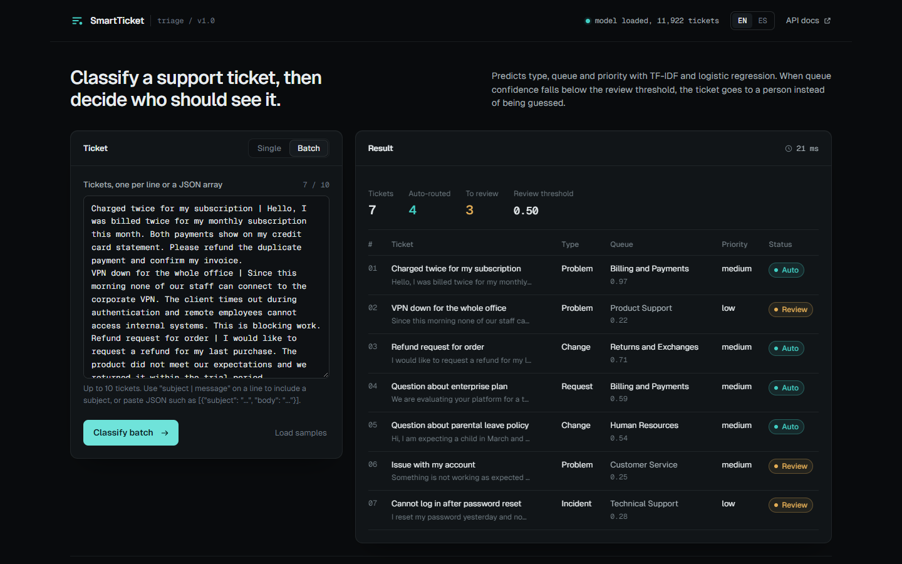
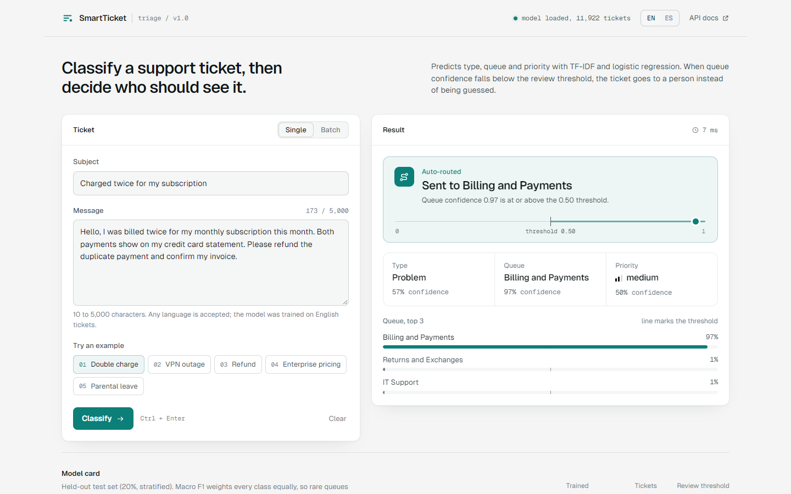
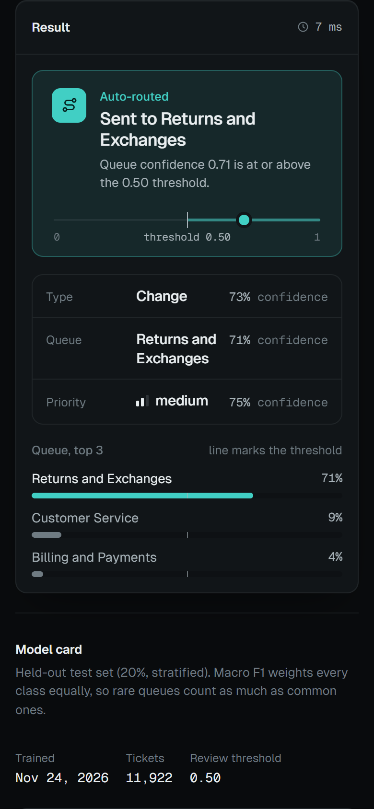

# SmartTicket: support-ticket triage API

A FastAPI service that classifies support tickets by **type**, **queue** (department) and **priority**. It uses TF-IDF and Logistic Regression and is trained on **11,922 real-world-style tickets**. When the model isn't confident, it sends the ticket to a human instead of guessing.

[](https://github.com/JovanySk/smartticket/actions/workflows/ci.yml)   

## Results (20% held-out test set, stratified, `random_state=42`)

| Target | Classes | Accuracy | **Macro F1** | Majority-class baseline (macro F1) |
|---|---|---|---|---|
| Type (Incident, Request, Problem, Change) | 4 | 0.84 | **0.85** | 0.14 |
| Priority (low, medium, high) | 3 | 0.61 | **0.59** | 0.20 |
| Queue (10 departments) | 10 | 0.53 | **0.51** | 0.04 |

Routing by queue is the hard task: it has 10 overlapping departments. So the API returns a **confidence** and a **`needs_review`** flag. At the threshold you pick, only confident tickets are auto-routed:

| Review threshold | Auto-routed tickets | Accuracy on auto-routed |
|---|---|---|
| 0.4 | 37% | 75% |
| **0.5 (default)** | **21%** | **85%** |
| 0.6 | 12% | 94% |
| 0.7 | 9% | 97% |

Full per-class precision, recall and F1 and the confusion matrices are in [`reports/metrics.json`](reports/metrics.json). Adding character n-grams didn't improve macro F1 and tripled training time, so the simpler word 1–2-gram model was kept.

## API

```http
POST /predict
{"subject": "Charged twice", "body": "I was billed twice for my subscription this month, please refund the duplicate payment."}
```

```json
{"type": {"label": "Problem", "confidence": 0.58},
 "queue": {"label": "Billing and Payments", "confidence": 0.91},
 "priority": {"label": "high", "confidence": 0.60},
 "queue_top3": [{"label": "Billing and Payments", "confidence": 0.91}, ...],
 "needs_review": false}
```

Also available:
- `POST /predict/batch`: up to 100 tickets.
- `GET /model-info`: metrics and training date.
- `GET /health`.
- Interactive docs at `/docs`.

Inputs are validated (body 10–5,000 characters). If the model is missing, the API returns 503.

## Web demo

`uvicorn smartticket.api:app` also serves a single-page demo at **http://localhost:8000/** (plain HTML, CSS and JS in `smartticket/static/`, no build step, so the Docker image is unchanged). It calls the same public endpoints as any client:

- **Single ticket**: write a subject and message or pick one of five sample tickets. You get type, queue and priority with confidence, the queue top 3, the request latency, and the routing decision: *auto-routed* when queue confidence reaches the review threshold, *needs human review* otherwise.
- **Batch**: paste up to 10 tickets (one per line, `subject | message`, or a JSON array) and get a table with review flags.
- **Model card**: training date, ticket count and macro F1 against the majority-class baseline, read from `GET /model-info`.
- English and Spanish UI, dark and light themes, keyboard accessible, responsive.

| Auto-routed | Needs human review |
|---|---|
|  |  |
| **Batch mode** | **Light theme** |
|  |  |

<p></p>

## Run it

```bash
pip install -r requirements.txt
python -m smartticket.train          # downloads the dataset and trains (~20 s), writes models/ and reports/
uvicorn smartticket.api:app --reload # demo at http://localhost:8000/, API docs at /docs
pytest -q                            # 15 tests
# or: docker build -t smartticket . && docker run -p 8000:8000 smartticket
```

## Tests

There are **15 pytest tests**. They train on a small offline fixture, so they need no network, and they cover:
- training and metrics;
- every endpoint and input validation;
- batch limits;
- the review flag;
- the 503 path;
- the web demo being served.

CI also retrains on the real dataset and runs a **quality gate**: type macro F1 ≥ 0.80, queue ≥ 0.45, and every target must be at least twice its baseline.

## Data

[Tobi-Bueck/customer-support-tickets](https://huggingface.co/datasets/Tobi-Bueck/customer-support-tickets) (CC BY-NC 4.0), English subset. The dataset is downloaded at training time and is not redistributed in this repo.

---
Author: **Jovany Morales del Ángel** · MIT License (code)
