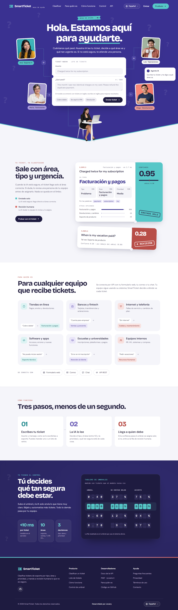
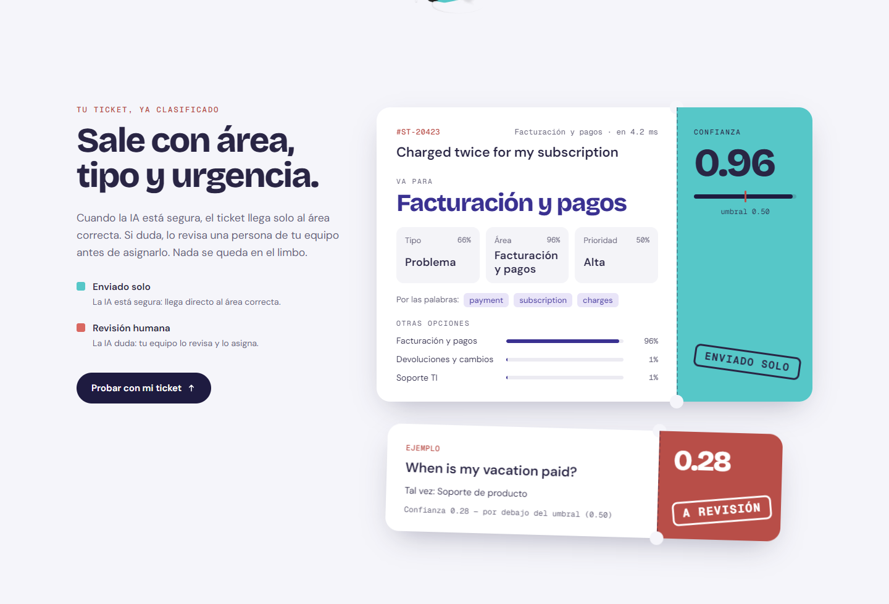
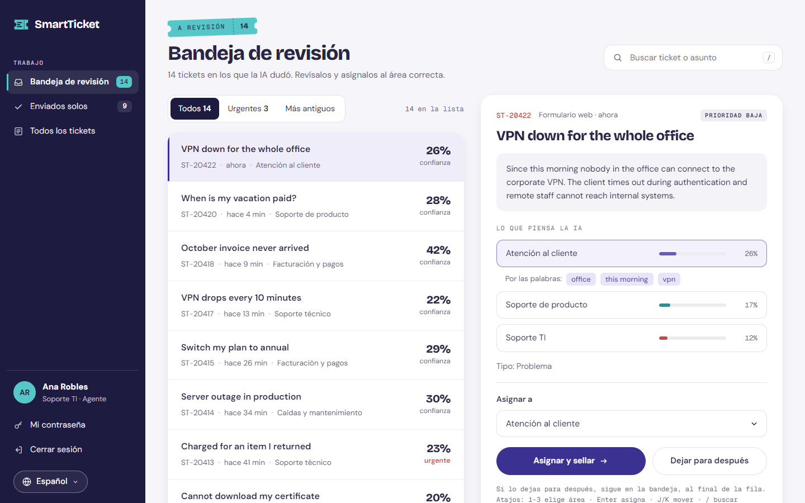
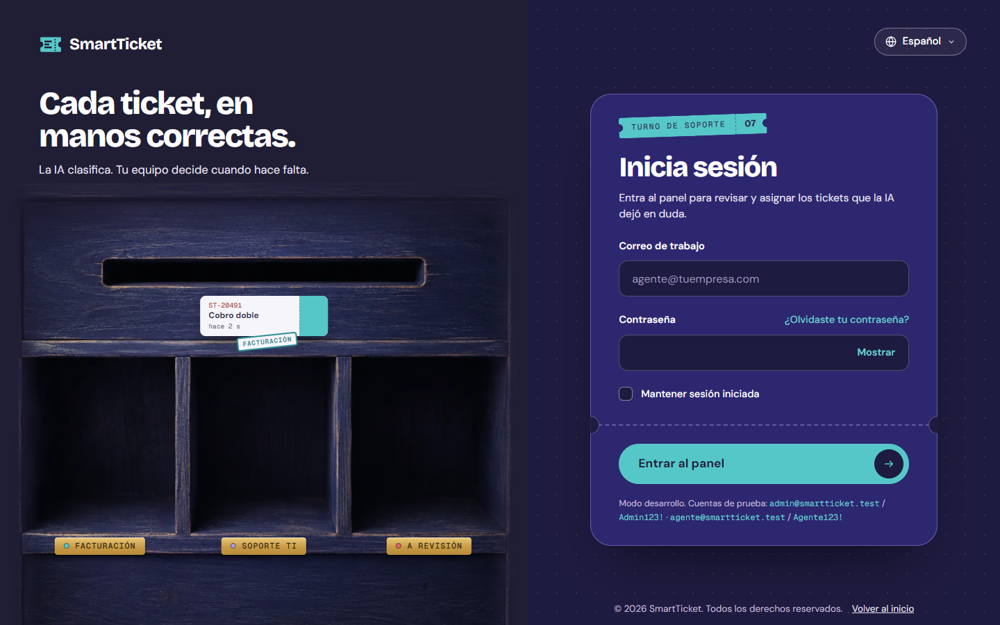
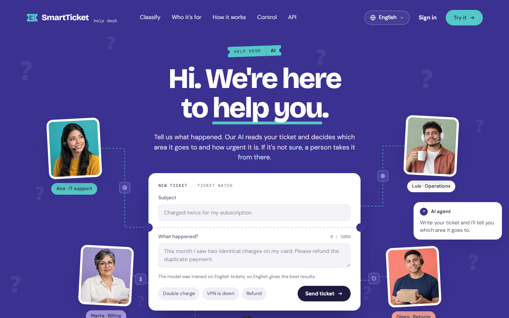
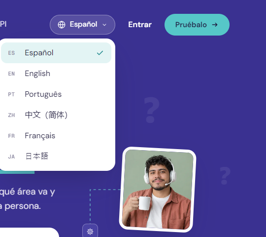
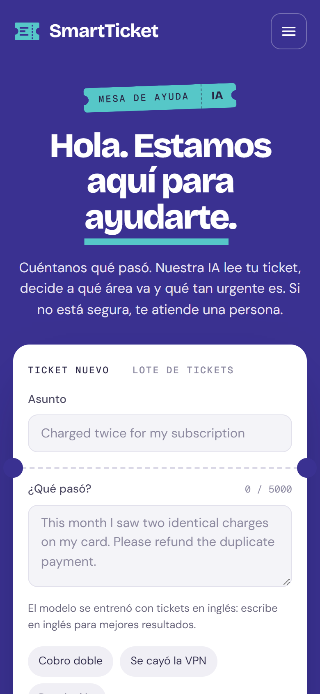

# SmartTicket: support-ticket triage with a human in the loop

SmartTicket classifies support tickets by **type**, **queue** (department) and **priority** with TF-IDF and Logistic Regression, trained on **11,922 real-world-style tickets**. When the model is confident, the ticket is routed automatically; when it isn't, it lands in a **review inbox** where a person assigns it. Every prediction shows the words that drove it.

[](https://github.com/JovanySk/smartticket/actions/workflows/ci.yml)   



## Results (20% held-out test set, stratified, `random_state=42`)

| Target | Classes | Accuracy | **Macro F1** | Majority-class baseline (macro F1) |
|---|---|---|---|---|
| Type (Incident, Request, Problem, Change) | 4 | 0.84 | **0.85** | 0.14 |
| Priority (low, medium, high) | 3 | 0.61 | **0.59** | 0.20 |
| Queue (10 departments) | 10 | 0.53 | **0.51** | 0.04 |

Routing by queue is the hard task: it has 10 overlapping departments. So every prediction carries a **confidence**, and only tickets at or above the **review threshold** are auto-routed:

| Review threshold | Auto-routed tickets | Accuracy on auto-routed |
|---|---|---|
| 0.4 | 37% | 75% |
| **0.5 (default)** | **21%** | **85%** |
| 0.6 | 12% | 94% |
| 0.7 | 9% | 97% |

The full sweep (0.30 to 0.90 in 0.05 steps) is computed at training time and stored in [`reports/metrics.json`](reports/metrics.json), together with per-class precision, recall, F1 and confusion matrices. The landing page and the admin panel read their numbers from that file. Adding character n-grams didn't improve macro F1 and tripled training time, so the simpler word 1–2-gram model was kept.

## What's in the app

- **Landing page with the real classifier.** The ticket-shaped form posts to `POST /tickets`; the ticket is stored, routed and shown as a ticket stub with type, area, priority, top-3 queues, latency and a rubber stamp: *auto-sent* or *to review*. A batch mode handles up to 10 tickets at once.
- **Explanations computed from the model.** For the predicted queue, each term contributes `tfidf_value × coefficient[queue, term]` to that class's score; the three largest positive contributions are returned as `top_words` (see `smartticket/inference.py`). Nothing is generated or hand-written.
- **Staff panel** (`/panel`, login required):
  - *Review inbox*: filters (all / urgent / oldest), search, the model's top 3 areas with bars, the words behind the top prediction, *Assign and stamp* (records who and when) and *Leave for later*. Keyboard: `1`–`3` pick an area, `Enter` assigns, `J`/`K` move, `/` searches.
  - *Auto-sent* and *All tickets* views.
  - Admin only: *Threshold and areas* (0.30–0.90, persisted and used for routing; a split-flap board with live counts and the expected accuracy from the held-out sweep), *Team* (create agents with a one-time temporary password, reset, deactivate) and *Contact messages*.
- **Help pages**: FAQ, privacy notice, terms of use and a working contact form (validation, honeypot, rate limit, stored in SQLite, readable by admins).
- **Six languages**: Spanish (default), English, Portuguese, Simplified Chinese, French and Japanese. Pages are translated on the server (no flash of the wrong language) and can be switched live from the globe menu; the choice is kept in a cookie and `localStorage`. Ticket content is never translated. Chinese and Japanese use system fonts instead of multi-megabyte web fonts.
- **Accessible and responsive**: keyboard navigation, visible focus, WCAG AA colour contrast, layouts down to phone width. Every animation (route lines, a mini ticket travelling to the agent who gets it, the typing bubble, the stamp, split-flap digits, the login sorting cabinet) is plain CSS / JavaScript, never moves over text and is switched off under `prefers-reduced-motion`.

The model was trained on English tickets, so the sample tickets are in English and the form says so; tickets in other languages are accepted but usually end up in human review.

| Result ticket | Staff review inbox |
|---|---|
|  |  |
| **Login** | **English UI** |
|  |  |

<p> </p>

## Security

- **Passwords** are hashed with `hashlib.scrypt` (random salt, N=2^14, r=8, p=1) and never stored in plain text. New passwords need at least 10 characters with letters and digits.
- **Sessions** are server-side: the browser gets a random token in an `HttpOnly`, `SameSite=Lax` cookie (`Secure` outside dev) and only its SHA-256 hash is stored. *Keep me signed in* extends it to 30 days; otherwise it lasts at most 12 hours and ends with the browser session. Logout is `POST` only. Changing a password signs out the account's other sessions; deactivating a user removes all of them.
- **CSRF**: every state-changing panel request must send the session's CSRF token in `X-CSRF-Token`. The pre-login forms (login, contact) use a double-submit token: a `SameSite=Strict` cookie plus the same value in the page.
- **Brute force**: login is limited to 5 attempts per minute per IP, and an account locks for 15 minutes after 5 consecutive failures. Errors are generic, and unknown e-mails cost the same hashing time as wrong passwords.
- **Roles**: `admin` and `agente`. Admin pages and endpoints return 403 for agents. Accounts created by an admin get a temporary password and must change it before they can use the panel.
- **No default credentials in production**: the first admin comes from `SMARTTICKET_ADMIN_EMAIL` / `SMARTTICKET_ADMIN_PASSWORD`. Demo accounts exist only when `SMARTTICKET_ENV=dev`.
- **Headers**: a strict Content-Security-Policy with no inline scripts or styles and `frame-ancestors 'none'`, `X-Content-Type-Options: nosniff`, `Referrer-Policy`, `X-Frame-Options: DENY`, `Permissions-Policy`, and HSTS outside dev. `/docs` gets a looser policy because Swagger UI loads from a CDN.
- Public ticket submission is rate-limited (30 per minute per IP); the contact form allows 3 messages per 10 minutes. Rate limits are in memory, so they apply per process.

## API

```http
POST /predict
{"subject": "Charged twice", "body": "I was billed twice for my subscription this month, please refund the duplicate payment."}
```

```json
{"type": {"label": "Problem", "confidence": 0.58},
 "queue": {"label": "Billing and Payments", "confidence": 0.91},
 "priority": {"label": "high", "confidence": 0.60},
 "queue_top3": [{"label": "Billing and Payments", "confidence": 0.91}, ...],
 "needs_review": false,
 "top_words": [{"word": "payment", "weight": 0.62}, {"word": "subscription", "weight": 0.41}, ...],
 "threshold": 0.5,
 "latency_ms": 3.1}
```

`/predict` is stateless and backward compatible: the original fields are unchanged, and `top_words`, `threshold` and `latency_ms` were added.

Also available:
- `POST /tickets`: classify, **store** and route one ticket. Returns `id`, `code` (e.g. `ST-20421`), `status` (`enviado` = auto-routed, `revision` = queued for a person) and the prediction.
- `POST /tickets/batch`: the same for up to 10 tickets.
- `POST /predict/batch`: stateless, up to 100 tickets.
- `GET /model-info`: metrics, training date, current threshold and the threshold sweep.
- `GET /health`.
- Interactive docs at `/docs`.

Inputs are validated (body 10–5,000 characters). If the model is missing, the API returns 503.

## Run it

```bash
python -m venv .venv && . .venv/bin/activate      # Windows: .venv\Scripts\activate
pip install -r requirements.txt -r requirements-dev.txt
python -m smartticket.train                        # downloads the dataset and trains (~40 s), writes models/ and reports/

# local development: demo accounts and sample tickets
SMARTTICKET_ENV=dev uvicorn smartticket.api:app --reload
# open http://localhost:8000/ ; staff log in at http://localhost:8000/login

pytest -q                                          # 48 tests
```

Demo accounts (**only** with `SMARTTICKET_ENV=dev`):

| Role | E-mail | Password |
|---|---|---|
| Admin | `admin@smartticket.test` | `Admin123!` |
| Agent | `agente@smartticket.test` | `Agente123!` |

In dev, 20 sample tickets are classified by the real model at startup, so the inbox has content.

Production-style run (serve it behind HTTPS, since session cookies are `Secure`):

```bash
SMARTTICKET_ADMIN_EMAIL=you@yourcompany.com SMARTTICKET_ADMIN_PASSWORD='a long passphrase 2026' \
  uvicorn smartticket.api:app --host 0.0.0.0 --port 8000
# or: docker build -t smartticket . && docker run -p 8000:8000 -e SMARTTICKET_ADMIN_EMAIL=... -e SMARTTICKET_ADMIN_PASSWORD=... smartticket
```

### Environment variables

| Variable | Default | Purpose |
|---|---|---|
| `SMARTTICKET_ENV` | `production` | `dev` enables demo accounts, sample tickets and non-`Secure` cookies for plain-HTTP localhost. |
| `SMARTTICKET_DB` | `data/smartticket.db` | SQLite file; it is created with its schema on startup. |
| `SMARTTICKET_MODEL` | `models/model.joblib` | Trained model bundle. |
| `SMARTTICKET_REVIEW_THRESHOLD` | `0.5` | Initial review threshold. After the first start, admins change it in the panel. |
| `SMARTTICKET_ADMIN_EMAIL` / `SMARTTICKET_ADMIN_PASSWORD` | – | Creates the first admin when no admin exists. The password must pass the strength rule. |
| `SMARTTICKET_SEED_DEMO` | `1` in dev | Set to `0` to start dev with an empty inbox. |

## Project layout

```
smartticket/
  api.py         FastAPI app factory: pages, public API, auth and panel endpoints, security headers
  inference.py   model loading, prediction and word-level explanations
  db.py          SQLite store (users, sessions, tickets, settings, contact messages)
  security.py    scrypt hashing, session tokens, CSRF helpers, rate limiter
  i18n.py        server-side page rendering and translation
  training.py    training pipeline and threshold sweep (train.py is the CLI)
  demo.py        dev-only demo accounts and sample tickets
  static/        pages/ (HTML templates and partials), css/, js/, i18n/ (6 locales), img/, fonts/ (self-hosted, OFL)
```

There is no build step: plain HTML, CSS and JavaScript, and no runtime dependencies beyond `requirements.txt`.

## Tests

There are **48 pytest tests**. They train on a small offline fixture, so they need no network, and they cover:
- training, metrics and the threshold sweep; every public endpoint and input validation;
- that the explanation words are exactly the top `tfidf × coefficient` terms of the fitted pipeline;
- storage and routing by threshold, and batch submission;
- login success and generic failures, cookie flags, the per-IP rate limit, account lockout, POST-only logout, scrypt hashes and no default admin in production;
- CSRF rejection, role protection, the assign / defer flow, filters and search, threshold changes, temporary passwords and deactivation;
- the contact form (validation, honeypot, rate limit, admin inbox);
- pages, footer links, security headers, rendering in each language, and that all six locale files have every key with matching placeholders.

CI also retrains on the real dataset and runs a **quality gate**: type macro F1 ≥ 0.80, queue ≥ 0.45, and every target must be at least twice its baseline.

## Data and credits

[Tobi-Bueck/customer-support-tickets](https://huggingface.co/datasets/Tobi-Bueck/customer-support-tickets) (CC BY-NC 4.0), English subset. The dataset is downloaded at training time and is not redistributed in this repo. Fonts: Bricolage Grotesque, DM Sans and Geist Mono, self-hosted under the SIL Open Font License (license files in `smartticket/static/fonts/`).

---
Author: **Jovany Morales del Ángel** · MIT License (code)
